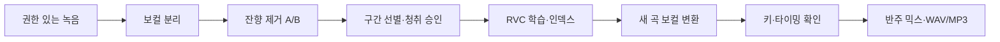

# AI 보컬 커버 만들기

### 음원 분리부터 RVC 학습·키 조정·믹싱까지, Windows 단계별 가이드

**내 목소리 또는 사용 허락을 받은 목소리로 노래 커버를 만드는 과정을 처음부터 끝까지 정리했습니다.** 원음 보존, 청취 검토, 단계별 기록을 중심으로 실제 Windows 프로젝트의 경험을 재구성했습니다.

RVC는 입력 가수의 노래에서 **멜로디·발음·타이밍을 가져와 목소리의 음색을 변환**합니다. 가사만 입력해 노래를 생성하는 도구는 아닙니다.



## 어디서 시작하나요?

| 현재 상태 | 시작할 단계 |
|---|---|
| 처음부터 목소리 모델을 만들고 싶다 | [1. 환경 준비](docs/01-setup.md) |
| 보컬은 있고 학습 데이터를 만들고 싶다 | [2. 분리·잔향 제거·청취 선별](docs/02-dataset.md) |
| 승인된 깨끗한 녹음이 있다 | [3. RVC 학습](docs/03-training.md) |
| 사용 허락을 받은 `.pth`와 `.index`가 있다 | [4. 새 곡 커버 제작](docs/04-cover.md) |
| 설치·학습·음질 문제가 생겼다 | [5. 문제 해결](docs/05-troubleshooting.md) |

## 따라 하는 순서

| 순서 | 할 일 | 다음 단계로 넘어가는 기준 |
|---|---|---|
| 1 | 프로젝트 폴더와 분리·학습 환경을 따로 준비 | FFmpeg와 CUDA가 각각 정상 동작 |
| 2 | 사용할 녹음과 출처를 기록 | 사용 권한 확인, 원음 SHA-256 저장 |
| 3 | 15~30초 시험 후 보컬 분리 | 악기 잔여·발음·고음을 직접 청취 |
| 4 | 잔향 제거 전후를 같은 음량으로 비교 | 더 나은 결과를 선택, 원본은 보존 |
| 5 | 짧은 후보를 만들고 한 개씩 검토 | 다른 화자·화음·손상 구간 제외 |
| 6 | 승인 구간만 별도 폴더에 확정 | CSV와 실제 WAV 목록 일치 |
| 7 | 전처리 → 특징/F0 → 인덱스 → 학습 | 누락·NaN·실패 로그 없이 산출물 확인 |
| 8 | 새로운 곡의 보컬·반주 분리 | 동일 시작점과 길이 확인 |
| 9 | 대표 20초 변환, 키와 보컬 균형 선택 | 저음·고음·자음·반주와의 조화 청취 |
| 10 | 전곡 변환·믹스·내보내기 | 전체 디코드, 길이, 클리핑, 전곡 청취 확인 |

**첫 목표는 한 곡의 대표 20초를 만족스럽게 만드는 것**입니다. 샘플 확인 후 전곡으로 확장하면 반복 시간을 줄일 수 있습니다.

## 필요한 것

- Windows 11, Python 3.12, FFmpeg. 이 가이드는 PowerShell 명령을 사용합니다.
- CUDA를 지원하는 NVIDIA GPU. 실제 사례는 RTX 5060 8GB·RAM 32GB에서 수행했습니다. 다른 GPU의 속도·메모리는 별도 확인해야 합니다.
- 학습용 녹음과 커버할 곡의 보컬/반주, 또는 분리할 원음.
- 분리: [audio-separator](https://github.com/nomadkaraoke/python-audio-separator), 학습·변환: [Applio](https://github.com/IAHispano/Applio).

## 이 저장소에 들어 있는 것

```text
ai-vocal-cover-guide/
├─ README.md
├─ docs/                  # 환경·데이터·학습·커버·문제 해결
├─ scripts/
│  ├─ workspace.ps1        # 프로젝트 내부 임시·캐시·작업 경로 준비
│  └─ audio_tools.py      # 전체 디코드 검사, 미리듣기, 믹스
├─ examples/              # 구간 CSV·설정 기록 예시
├─ requirements.txt       # 보조 도구용 최소 의존성
└─ LICENSE
```

실행하면 `data/`, `models/`, `outputs/`, `tools/`, `.tmp/`, `.cache/`를 사용합니다. 이 폴더들은 Git에서 제외됩니다. 보조 도구는 **명시한 입력만 처리하며 기존 출력 파일을 덮어쓰지 않습니다.** 분리·학습·RVC 변환은 문서의 외부 도구를 직접 실행합니다.

원곡, 학습 음성, 학습된 가수 모델, 완성 커버, 기존 실행 로그는 배포하지 않습니다. 자신이 사용할 수 있는 자료를 직접 준비하세요. 소스코드의 MIT 라이선스가 음원·목소리·외부 모델의 사용 권한을 부여하지는 않습니다.

## 검증 범위

기존 프로젝트에서는 20곡 분리·잔향 제거, 승인 17곡 기반 100 epoch 학습, 별도 곡 커버와 반음 비교까지 수행했습니다. [실제 사례와 한계](docs/CASE-STUDY.md)에 수치와 주의점을 구분했습니다.

공개용 보조 도구는 합성 신호로 검사했습니다. **이 공개 폴더를 새 PC에 설치해 전체 분리·재학습을 다시 수행한 것은 아닙니다.** 패키지·GPU·모델 공급 상태가 다르면 [환경 준비](docs/01-setup.md)와 [공식 출처](docs/REFERENCES.md)를 함께 확인하세요. 파일 검사 통과와 청취 음질 평가는 별개의 과정입니다.

개선 제안은 Issue로, 코드·문서 수정은 Pull Request로 남겨 주세요. 음원이나 개인 목소리 파일 대신 재현 순서·도구 버전·민감정보를 제거한 오류를 첨부하면 됩니다.
